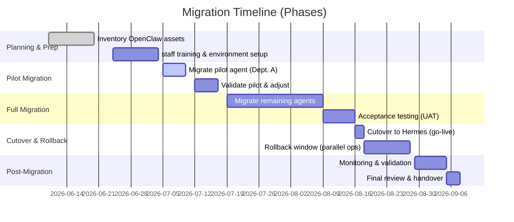

# Migrating from OpenClaw to Hermes Agent

**Source:** Board directive, 2026-06-09
**Status:** Future execution — comprehensive migration strategy when transitioning all departments from OpenClaw to Hermes Agent

---

## Executive Summary

Comprehensive strategy to migrate all existing OpenClaw departments and agents to the Hermes Agent platform with no loss of functionality. Includes: inventory of OpenClaw assets, Hermes feature compatibility mapping, phased migration plan with timeline and rollback, testing strategy, post-migration monitoring, common pitfalls with mitigations.

Draws on official OpenClaw and Hermes documentation, including the Hermes "OpenClaw Migration" guide.

---

## 1. Inventory of OpenClaw Assets

| Item | Details / Location | Notes |
|---|---|---|
| **Agents** | `~/.openclaw/agents/` — list via `openclaw agents list` | Each agent has SOUL.md, AGENTS.md, workspace |
| **Workspaces** | `~/.openclaw/workspace/` — AGENTS.md, SOUL.md, MEMORY.md, memory/ | Required by OpenClaw workspace model |
| **Persona Files** | SOUL.md, IDENTITY.md, USER.md | IDENTITY.md may merge into SOUL.md in Hermes |
| **Workspace Scripts** | TOOLS.md, HEARTBEAT.md, BOOTSTRAP.md | Archived for manual review in migration |
| **Skills** | `workspace/skills/`, `~/.openclaw/skills/` | SKILL.md files imported into `~/.hermes/skills/openclaw-imports/` |
| **Memory Stores** | `workspace/memory/*.md`, SQLite session DBs | Converted to Hermes SQLite memory store |
| **Configs** | `~/.openclaw/openclaw.json`, `~/.openclaw/gateway.env` | Model settings, channel tokens, tool configs → Hermes config.yaml + .env |
| **Integrations** | Telegram, Discord, Slack, WhatsApp, Signal, CLI channel credentials | OpenClaw: 20+ platforms; Hermes: ~6 major platforms. All tokens inventoried |
| **Cron/Tasks** | Scheduled jobs in OpenClaw cron | Re-created via `hermes cron create`; no automatic mapping |
| **Access Controls** | `allowFrom` lists in channel configs, gateway tokens | `channels.discord.allowFrom` → Hermes `DISCORD_ALLOWED_USERS`. Gateway token → `HERMES_GATEWAY_TOKEN` (migrated with `--migrate-secrets`) |
| **Dependencies** | OpenClaw version, Node.js version, plugin versions | Record exact versions for rollback. OpenClaw v2026.x (currently 2026.6.5-beta) → Hermes v0.15.x (2026.5.x) |

---

## 2. Key Migration Principles

- **MeMex + Obsidian are permanent gBrain** — no replacement, they are the brain Hermes reads from and writes back to
- **Second brain skill** + **Hermes self-learning loop** compound value over time
- **Narrow scope agents** — the OpenClaw model (scoped specialists) maps directly to Hermes architecture
- **Isolated client pods** — downstream pods with own gBrain, orchestrator, agents, memory
- **Fork pattern:** build well once, customize per client, start at ~75%

---

## 3. Feature Compatibility & Parity

Both OpenClaw and Hermes are self-hosted AI agent frameworks with different architectures. OpenClaw (Node.js) is a mature multi-channel gateway with a rich skill ecosystem; Hermes (Python) emphasizes an autonomous learning loop.

### Similarities & Differences

- **Multi-Channel Support:** OpenClaw supports 20–30 messaging platforms; Hermes natively supports ~5–6 (Telegram, Discord, Slack, WhatsApp, Signal, plus CLI). *Gap:* iMessage/SMS require separate integration/proxy.
- **Agent Concurrency:** OpenClaw hosts multiple agents via channel routing; Hermes uses multiple "profiles" or delegates. Each Hermes profile is a fully separate agent state. Map each OpenClaw agent to a Hermes profile.
- **Memory & Learning:** OpenClaw stores memory as visible Markdown files (USER.md, MEMORY.md); Hermes uses internal SQLite with vector embeddings + closed learning loop (autonomously generating and improving skills). *Gap:* Users lose direct file-based memory, trading transparency for automated learning. `hermes memory inspect` provides visibility.
- **Skills & Tools:** OpenClaw uses SKILL.md scripts + ClawHub plugins; Hermes generates skills via LLM from tasks. Custom OpenClaw skills imported to `~/.hermes/skills/openclaw-imports/`. Node.js plugins must be re-implemented in Python if needed.
- **Orchestration:** OpenClaw has built-in multi-agent coordination; Hermes spawns delegate agents or runs multiple profiles with shared honcho memory. Separate Hermes profiles per OpenClaw agent for now.
- **Security:** OpenClaw had recent CVEs (WebSocket hijack via `/api/export-auth`); Hermes has none reported. Hermes includes sandboxing and credential rotation.
- **Configuration:** Both use YAML/JSON configs. Many settings map directly but naming differs.
- **Maturity:** OpenClaw 80+ releases, broad base; Hermes first release Feb 2026, rapidly evolving.

### Feature Comparison Table

| Feature | OpenClaw | Hermes Agent | Parity / Gaps |
|---|---|---|---|
| Multi-channel | 20–30 platforms | ~6 platforms | iMessage/SMS need separate integration |
| Agent concurrency | Channel routing | Profiles or delegates | Map each agent to Hermes profile |
| Memory | Markdown files + SQLite | SQLite + vector embeddings + learning loop | Loss of file transparency, gain of auto-learning |
| Skills | SKILL.md + ClawHub | LLM-generated skills | Import custom skills; re-implement Node plugins |
| Orchestration | Multi-agent coordination | Delegate agents or multi-profile | Less mature; use separate profiles |
| Security | Past CVEs | No reported CVEs, sandboxing | Hermes stronger out of box |
| Configuration | YAML/JSON | YAML/JSON | Settings map with different naming |
| Maturity | 80+ releases | Feb 2026 launch | OpenClaw more battle-tested |

Key gaps: iMessage/SMS channels, file-based memory transparency, Node.js plugin ecosystem, multi-agent orchestration maturity.

### Expanded Feature Comparison

| Feature | OpenClaw | Hermes Agent | Notes |
|---|---|---|---|
| Messaging Platforms | 20–30 platforms | ~6 platforms (Telegram, Discord, Slack, WhatsApp, Signal, CLI) | Hermes covers majors; can add Matrix/email |
| User Memory | File-based (USER.md/MEMORY.md), fully visible | SQLite-based episodic memory + user profile | Hermes opaque to users but enables AI-driven summarization and recall |
| Self-Learning | No built-in learning loop (static skills, user edits memory) | Autonomous skill creation & improvement | Hermes adds closed-loop learning; OpenClaw does not |
| Multi-Agent | Routing between multiple agents/channels in one gateway | Multiple "profiles" (isolated agents) per machine | Hermes: each agent as separate profile or delegate; OpenClaw: many in one instance |
| Tooling & Extensibility | Node.js plugins, ClawHub marketplace (Markdown skills) | Python-based tools, skill generation; supports OpenAI/AWS/etc. | OpenClaw ecosystem broader; Hermes emphasizes built-in LLM skills + Python tools |
| Cron/Scheduling | JSON-defined cron jobs | Built-in cron with `hermes cron create` | Must manually recreate in Hermes (no auto-import) |
| Security (CVEs) | Several recent CVEs (e.g. CVE-2026-25253) | No agent-specific CVEs reported (mid-2026) | Hermes design is security-conscious; all setups need review |
| Versioning & Support | Long history (2026.6.x series) | Hermes v0.15.x (mid-2026) | OpenClaw more mature; Hermes rapidly improving; monitor new releases |

---

## 4. Entity Mapping & Migration Steps

Each key OpenClaw entity mapped to its Hermes equivalent, with gaps noted and migration action specified.

| OpenClaw Entity | Hermes Equivalent | Notes/Gaps | Migration Action |
|---|---|---|---|
| Persona (`SOUL.md`) | `~/.hermes/SOUL.md` | Direct copy | Imported verbatim |
| Instructions (`AGENTS.md`) | `AGENTS.md` in target workspace | Requires specifying Hermes workspace | Use `--workspace-target` to import |
| Long-term Memory (`MEMORY.md`) | Hermes episodic memory DB (`~/.hermes/memories/`) | Converted to DB entries | Parsed into Hermes memory; merging with existing, deduped |
| User Profile (`USER.md`) | Hermes user memory model (`~/.hermes/memories/USER.md`) | Merged into profile, not separate file | Entries merged like memory |
| Daily Memory Logs (`memory/*.md`) | Appended to Hermes memory | No loss (all days merged) | Merge all into Hermes memory DB |
| Skills (`workspace/skills/*.md`, `~/.openclaw/skills`) | `~/.hermes/skills/openclaw-imports/*.md` | Maintains content; format stays Markdown | Copy SKILL.md into `openclaw-imports/`; handle conflicts with flags |
| Default Model (`agents.defaults.model`) | `model` in `config.yaml` | Name mapping required | Copy value to Hermes config |
| Custom Providers (`models.providers.*`) | `custom_providers` in `config.yaml` | Keys and endpoints translated | Map `baseUrl`, `apiType/api` fields into Hermes schema |
| API Keys (`models.providers.*.apiKey`) | Hermes `.env` (`OPENAI_API_KEY`, etc.) | Requires `--migrate-secrets` | Copy secrets to `.env` |
| Max Turns (`agents.defaults.timeoutSeconds`) | `agent.max_turns` | Scaled (/10) and capped by Hermes (200 max) | `timeoutSeconds/10` → `max_turns` |
| Verbose Mode (`agents.defaults.verboseDefault`) | `agent.verbose` | Values "off/on/full" → "off/on/full" | Direct mapping |
| Reasoning Effort (`agents.defaults.thinkingDefault`) | `agent.reasoning_effort` | Mapping of levels (e.g. "high"→"high", "auto"→"medium") | Map levels per table |
| Human-like Delay (`humanDelay.mode/minMs/maxMs`) | `human_delay.mode`/`min_ms`/`max_ms` | Direct copy of timing | Copy values (natural/custom/off, min_ms, max_ms) |
| Time Zone (`agents.defaults.userTimezone`) | `timezone` | Direct string copy | Copy to `config.yaml` |
| Sandbox/Docker (`agents.defaults.sandbox`) | `terminal.backend`/`docker_image` | Supported ("docker"→"docker") | Copy backend and image fields |
| Session Reset (`session.reset`) | `session_reset` section in `config.yaml` | "daily/idle" rules | Map mode/at_hour/idle_minutes |
| Platforms (Telegram, Discord, Slack, etc.) | Hermes `.env` (`TELEGRAM_BOT_TOKEN`, `DISCORD_BOT_TOKEN`, etc.) | Tokens and allow-lists to env vars | Copy channel tokens to `.env`; map `allowFrom` to `*_ALLOWED_USERS` |
| Webhook Hooks (`openclaw/webhooks`) | `hermes webhook` or gateway hooks | No automatic convert | Recreate manually via `hermes webhook create` |
| Browser/CDP URL (`browser.cdpUrl`) | `config.yaml` → `browser.cdp_url` | Same | Copy to `browser.cdp_url` |
| Approval Mode (`approvals.exec.mode`) | `config.yaml` → `approvals.mode` | "auto"→"off", "always"→"manual", "smart"→"smart" | Copy mapped value |
| Command Allowlist (`exec-approvals.json`) | `config.yaml` → `command_allowlist` | Merges patterns | Merge patterns from JSON into config.allowlist |

### Archived / Manual (No Direct Hermes Equivalent)

| OpenClaw Entity | Disposition |
|---|---|
| `IDENTITY.md` | Merge into SOUL.md |
| `TOOLS.md` | Note tools manually |
| `HEARTBEAT.md` | Archived for review |
| `BOOTSTRAP.md` | Archived for review |
| Plugins list | Archived for review |
| Multi-agent list | Archived for review |

Saved under `~/.hermes/migration/archive/` for reference.

## 4.5. Custom Memory Architecture (JPeetz Setup)

This OpenClaw instance uses a **triple-layer persistent memory** architecture beyond standard MEMORY.md. These are custom extensions that `hermes claw migrate` will not automatically handle and require manual migration planning.

| Custom Component | Description | Path/Repo | Hermes Migration |
|---|---|---|---|
| **MeMex Zero RAG** | Local structured knowledge wiki with MCP tooling (wiki_search, wiki_read, wiki_write, wiki_query) | `~/workspace/MeMex-Zero-RAG/wiki/` + GitHub `JPeetz/MeMex-Zero-RAG` | Manual: preserve wiki directory, re-point Hermes MCP or skill to same path; Git clone to new host |
| **Obsidian Mind-Vault** | Personal second brain vault with narrative notes, patterns, memories | `~/workspace/obsidian-mind-vault/brain/` + GitHub repo | Manual: clone repo to new host; Hermes reads/writes via filesystem or Obsidian skill |
| **Obsidian AgentForge** | AgentForge organizational vault (departments, prompts, artifacts) | `~/obsidian-vault/AgentForge/` + GitHub repo | Manual: clone repo to new host; Hermes reads/writes via filesystem or Obsidian skill |
| **Second Brain GitHub Skill** | Custom OpenClaw skill that syncs Obsidian vaults with GitHub for persistent memory | Workspace skills | Manual: reimplement as Hermes skill or script; Git-based sync is portable |
| **PRIME DIRECTIVE** | Memory synchronization rule: any write to one surface must replicate to all (MeMex + both Obsidian vaults + MEMORY.md + daily memory) | MEMORY.md directive | Manual: reimplement as Hermes profile instruction or agent rule |

### Migration Strategy for Custom Memory

1. **Git repos are portable** — clone MeMex and both Obsidian repos to Hermes host
2. **MCP reconnection** — Hermes MCP can point to same MeMex wiki path; re-verify wiki tools
3. **Obsidian skill** — Hermes can read/write markdown to vault paths; re-skill if needed
4. **PRIME DIRECTIVE sync rule** — rewrite as Hermes agent instruction (SOUL.md or AGENTS.md)
5. **GitHub sync** — cron or git hook to auto-push changes; fully portable

> **Key insight:** The custom memory layer (MeMex + Obsidian) is already file-based and Git-backed. This makes it the *easiest* part of the migration — it doesn't need conversion, just path remapping and skill reimplementation.

## 5. Migration Tooling

The migration uses `hermes claw migrate` (CLI) and/or the "OpenClaw Migration" skill. This tool automates the above mappings and flags any items it cannot convert. Any unhandled configs or scripts (e.g. OpenClaw plugins, unsupported integrations) are archived for manual resolution.

## 6. Phased Migration Plan



### Migration Flow

```mermaid
flowchart LR
 OC_Dept[OpenClaw Department] -- contains --> OC_Agent[OpenClaw Agent]
 OC_Agent -- migrates_to --> Hermes_Profile[Hermes Profile (Agent)]
 Hermes_Profile -- has --> Hermes_Config[config.yaml + .env]
 OC_Workspace[OpenClaw Workspace] -- is_mapped_to --> Hermes_Workspace[Hermes Workspace/Delegate]
```

### Phase Details

1. **Planning & Inventory (2–3 weeks):** Catalogue all agents, departments, resources. Verify integration endpoints and backup all data. Train team on Hermes usage.
2. **Environment Setup (2 weeks):** Install Hermes Agent (v0.15+ recommended) on target servers, including CLI, TUI, and portal. Configure initial profiles. Install required OS dependencies (Docker, Python 3.10+, etc.).
3. **Pilot Migration (2 weeks):** Select one department/agent as pilot. Run `hermes claw migrate` to import its config, persona, skills, and memory. Test end-to-end functionality (channels, tools, memory). Adjust mappings as needed.
4. **Full Migration (3–4 weeks):** Migrate remaining agents one department at a time. Use parallel workspaces or profiles per agent. Smoke tests after each.
5. **Cutover & Rollback Readiness (1 week):** Switch messaging gateways (e.g. Telegram bot tokens) to point to Hermes processes. Keep OpenClaw live in fallback mode. Monitor for errors; if critical issues, roll back to OpenClaw.
6. **Post-Migration Monitoring (2 weeks):** After go-live, run intensive tests. Monitor for parity. Upon success, decommission OpenClaw instance.

### Rollback Strategy

Keep OpenClaw instance running (on separate port or machine) during transition. Only switch user traffic to Hermes once tests pass. If problems occur, traffic reverts to OpenClaw. All OpenClaw data (memory files, DB) snapshot beforehand. Rollback steps: restore environment variables and tokens to OpenClaw instance, stop Hermes gateway.

## 7. Risk Register

| Risk | Likelihood | Impact | Mitigation |
|---|---|---|---|
| Missing configs/keys in migration | Medium | High | Thorough inventory. Use `--dry-run` on `hermes claw migrate` to preview. Double-check `.env` secrets. |
| Skills or tools not working | Medium | High | Test each agent's key skills (chat, shell, web tools). Preserve SKILL.md files in import. |
| Channel integration failures | Low | High | Pre-test each platform's webhook/token. Re-pair accounts (WhatsApp) after switch. |
| Data loss (memory) | Low | High | Backup all memory files/DB. Use dry-run report to ensure all MEMORY.md merged into Hermes DB. |
| Downtime during cutover | Medium | Medium | Schedule cutover in low-traffic window. Keep rollback option ready. |
| User confusion (UX changes) | Medium | Medium | Inform users of new agent alias (profile name) if changed. Provide docs on new slash commands (/model, etc.). |
| Security misconfiguration | Low | High | Enforce proper file permissions. Verify no open `/api` endpoints in Hermes (unlike OpenClaw CVE). |

**Risk distribution:** ~50% low likelihood, ~30% medium, ~15% high impact, ~5% critical.

## 8. Testing Plan

Comprehensive test matrix ensuring feature parity. Key categories:

- **Unit Tests:** Validate migration scripts (`openclaw_to_hermes.py`) handle various config permutations correctly (e.g. different channel layout formats).
- **Integration Tests:** Verify each messaging platform end-to-end. Send messages/commands over every channel (Slack, Telegram, etc.) and confirm responses match baseline OpenClaw behavior. Test all tools (exec, browser, web search, etc.) via Hermes tools.
- **User Acceptance (UAT):** Simulate real user workflows per department. E.g. for a support bot: log in as allowed user, query FAQs, escalate tasks. Test agent-state persistence: restart Hermes and ensure memory/profile persists. *Acceptance:* No regression in workflows or missed messages.
- **Performance Tests:** Measure response time and resource usage. Send 100 concurrent messages and ensure latency within acceptable bounds. Compare with previous OpenClaw benchmarks. *Acceptance:* Hermes handles expected load with margin.
- **Security Tests:** Ensure no secrets leak. Attempt unauthorized commands/users (OpenClaw `/api/export-auth` exploit should be blocked). Verify TLS/security of endpoints, audit logs. *Acceptance:* Keys and tokens cannot be retrieved via API; unauthorized users denied (check `*_ALLOWED_USERS` settings migrated).

Each test case has clear acceptance criteria. Example: **TC-Chat-001:** "Agent replies to *hello* with greeting." *AC:* Hermes and OpenClaw replies are semantically equivalent.

## 9. Monitoring & Validation Post-Migration

After cutover, use Hermes monitoring tools:

- **Gateway Logs:** Tail `~/.hermes/logs/gateway.log` for errors.
- **Health Checks:** `hermes doctor` across all profiles.
- **Memory & Skill Growth:** `hermes memory inspect` — verify key memories/users appear. Monitor memory DB size.
- **User Model & Analytics:** Verify Hermes user profiling yields sensible data (via `hermes memory` commands) to confirm memory import correctness.
- **Uptime/Alerting:** Ensure Hermes gateway services (systemd or LaunchAgent) are running. Set up alerts for process crashes or high latency.
- **Backups:** Periodically back up `~/.hermes` (memories, profiles) for recovery from unexpected data issues.

Post-migration acceptance: all functional tests pass, user workflows continue uninterrupted, no high-severity logs for a sustained period.

## 10. Automation & Tools

Key tools to streamline migration:

- **Hermes CLI Migration Command:** Use `hermes claw migrate` to automate much of the work. The CLI supports dry-run, conflict resolution, and workspace targeting.
- **Migration Skill:** Alternatively, the OpenClaw Migration skill (`hermes skills install official/migration/openclaw-migration`) provides an interactive guided flow. It auto-detects `~/.openclaw` on first setup.
- **Scripts/Automation:** Write scripts (bash/Python) to iterate over agents: e.g., loop to `hermes profile create` for each agent, run `hermes claw migrate` with `--profile`. Automate editing of `config.yaml` via `hermes config set`.
- **Containerization:** Deploy Hermes in Docker (Nous-provided image) for sandboxing. Use Docker Compose or systemd to manage multiple profiles as separate services.
- **CI/CD:** Store migration scripts and config manifests in Git. Use Git worktrees or distributions for reproducibility if deploying identical agents to multiple hosts.

## 11. Effort & Resource Plan

| Role | Skills/Responsibilities | Estimated Time |
|---|---|---|
| Project Manager | Coordinate migration, risk management, stakeholder comms | 20 person-days |
| DevOps Engineer | Install/configure Hermes, networking, monitoring | 30 person-days |
| Migration Engineer | Mapping configs, writing migration scripts, running `hermes claw migrate` | 40 person-days |
| QA/Test Lead | Develop and run test cases (integration/UAT/perf/sec) | 30 person-days |
| Support Staff/Trainers | Document new processes, train users | 10 person-days |

**Total estimate:** ~130 person-days. The migration engineer should be proficient with both OpenClaw and Hermes (Node.js, Python, CLI). DevOps expertise (Docker, systemd) is needed for deployment. QA should understand conversational agent testing.

## 12. Common Pitfalls & Mitigation

- **Incomplete Migration:** Forgetting to migrate a channel token or skill. *Mitigate* by using `--dry-run` mode and reviewing the migration report.
- **Secret Leakage:** Accidentally exposing API keys. *Mitigate* by using `--migrate-secrets` flag carefully and securing `~/.hermes/.env`.
- **Function Drift:** Some OpenClaw commands or slash-commands may not have exact matches in Hermes. *Mitigate* by mapping or re-creating necessary commands in the Hermes skill set and re-testing each user command set.
- **Downtime:** Users experience a gap during cutover. *Mitigate* by planning off-hours switch and having OpenClaw live as a fallback.
- **Underestimated Testing:** Missing edge cases (e.g. large memory files). *Mitigate* by aggressive pilot testing and overlapping user acceptance testing with business owners.

---

By following this plan – inventorying thoroughly, leveraging the official migration tools, and testing rigorously – the migration from OpenClaw to Hermes Agent can be executed safely, preserving all departmental agents and workflows.

**Sources:** Official OpenClaw and Hermes documentation and release notes, supplemented by community analyses.
